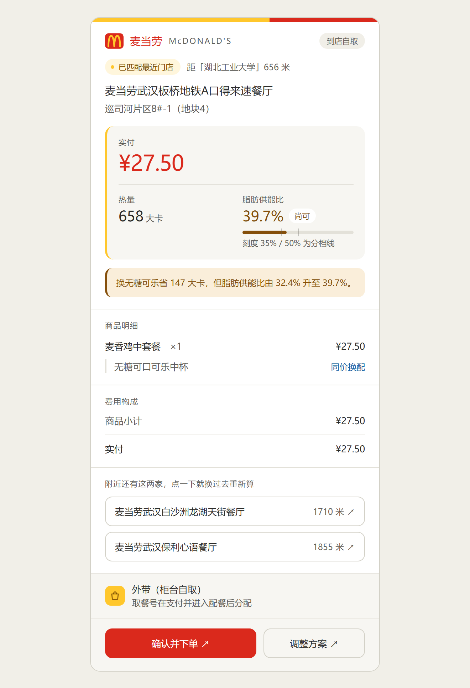
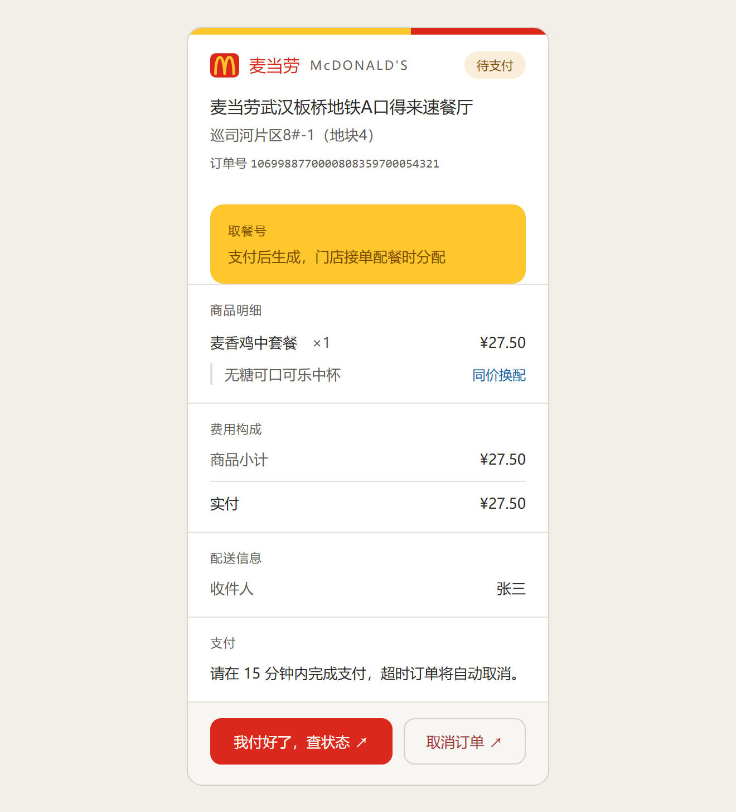

# 麦惠生活 · mcd-hui-life

**麦惠生活**是一个麦当劳点餐 Skill，**同时管住「花多少钱」和「摄入多少热量」两条预算**，算出真实可下单的搭配，并按需判定「不油腻」。名字里的「麦」是麦当劳，「惠」是实惠——省下的不只是钱，还有热量。

> 双预算 + 清淡偏好 + 券省钱，三者交叉求解，并且每个数字都经过麦当劳 MCP 的真实接口验证。

## 目标用户

| 用户 | 他们的原话 | 这个 Skill 给什么 |
|---|---|---|
| 控卡党 | 「500 大卡以内，20 块搞定」 | 在热量与金额双约束下求解，给出真实成交价 |
| 减脂 / 健身人群 | 「想吃清淡点」「别太油腻」 | 按脂肪供能比分档，用实算数据而不是餐品名判断 |
| 学生与预算敏感用户 | 「有没有更便宜的搭配」「用券能省多少」 | 交叉校验门店可用券，把券当特价商品纳入比较 |
| 有明确目标的用户 | 「我想吃巨无霸，帮我配一下」 | 锚定该商品，只在周围补齐搭配 |
| 只想省事的用户 | 「帮我点一份」 | 输出方案并代为创建订单（需明确确认），并自动选好最近的门店 |
| 不知道去哪家的用户 | 「离我最近的店」「我在湖北工业大学附近」 | 按位置锚点自动匹配最近且真能下单的门店，而不是只按直线距离排序 |

## 为什么需要它

麦当劳 MCP 同时暴露了菜单、券、报价、营养、下单五套独立数据源，它们之间存在**三组系统性偏差**。直接问模型会踩坑，本 Skill 的核心就是把这些偏差逐个消掉：

| 坑 | 实测证据 | 本 Skill 的处理 |
|---|---|---|
| 菜单返回 ≠ 可售 | 餐段空窗期会拿到已停售餐品，报价可能返回 `60006`「商品已售罄或不可售」——但空窗期**不必然拦截**，实测同一空窗期内 4 次报价全部成功 | 每个候选都先经报价接口确认可售，**不据时段预判** |
| 菜单价 ≠ 成交价 | 燕麦奶铁菜单价 9.9 元，成交价 **23 元** | 只报报价接口金额；需持卡的标注「需持卡」 |
| 卡包券 ≠ 可用券 | 同一时刻卡包 **11 张**、门店可用 **2 张** | 券必须经门店券接口交叉校验 |
| 券是特价商品，不是折扣 | 「王牌小食拼」是独立商品码 `9900016371` | 券按商品拆解，营养由组成品求和 |

另外还发现了一个**免费的操作空间**：券商品拆解后，同一轮内 `diffPrice` 为 `+ ¥0` 的选项互为等价备选。实测「王牌小食拼」可等价换成 **15 种**组合——不加一分钱就能调整营养结构。

## 安装方法

### 前置条件

1. 一个麦当劳中国的 MCP Token
2. Python 3.10 或以上（脚本只用标准库，无需装任何第三方包）
3. 可访问 `https://open.mcd.cn` 的网络

### 第一步：申请 MCP Token

1. 打开 https://open.mcd.cn/mcp
2. 点击右上角「登录」，用手机号完成验证
3. 点击右上角「控制台」→「激活」
4. 阅读并同意服务协议，复制 Token

### 第二步：配置连接器

打开 WorkBuddy，左侧边栏「专家·技能·连接器」→「连接器」页签 → 右上角「自定义连接器」→「配置 MCP」，填入：

```json
{
  "mcpServers": {
    "mcd-mcp": {
      "type": "streamablehttp",
      "url": "https://mcp.mcd.cn",
      "headers": {
        "Authorization": "Bearer YOUR_MCP_TOKEN"
      }
    }
  }
}
```

> 务必把 `YOUR_MCP_TOKEN` 替换为实际 Token 再保存。同一内容也放在 [`mcp-config.example.json`](./mcp-config.example.json)。

保存后回到「自定义连接器」列表，把 `mcd-mcp` **启用**并点击**信任**。

### 第三步：安装 Skill

把本目录放到 Skill 目录下即可：

```text
# 用户级（所有项目可用）
~/.workbuddy/skills/mcd-hui-life/

# 或项目级
<项目>/.workbuddy/skills/mcd-hui-life/
```

### 第四步：验证环境

Skill 在正式流程前会自动跑一次只读环境检查。也可以手动验证：

```bash
# 1. 先做最小探测：调用 now-time-info，能返回当前时间即说明鉴权与连通正常
# 2. 把探测结果按 references/setup-guide.md 的格式写成 probe-results.json
# 3. 带 --network 与探测结果再跑检查
python scripts/check_environment.py --network --probe-results probe-results.json
```

**漏掉 `--network` 或 `--probe-results` 会直接返回 `unavailable`**（`reason_code` 为 `probe_required`），那不是环境有问题，而是检查没拿到探测结果，别据此判定 MCP 不可用。

返回 `status: "ready"` 即可开始使用；`partial` 可继续，但要留意受限功能；`needs_setup` 时按输出的配置步骤补齐后重新检查；`unavailable` 时按 `reason_code` 区分认证失效、限流、服务故障与探测未开启。

## 使用示例

### 示例一：双预算 + 清淡偏好（实测输出）

**用户说**：「中午 500 大卡以内、20 元以内、别太油腻」

**Skill 输出**（门店：麦当劳武汉江夏永旺梦乐城餐厅 `storeCode` 1960242，到店自取；以下数字均为实测值）：

```text
**① 王牌小食拼（麦辣鸡翅2块 + 无糖可口可乐中杯）**　←　主推
- 餐品：王牌小食拼 ×1（含麦辣鸡翅2块、无糖可口可乐中杯）
- 用券：王牌小食拼（券价 15.9 元）
- 营养：224 大卡｜蛋白质 13g｜脂肪 15g（供能比 60.3%）｜钠 572mg
- 价格：原价 22.5 元 → 实付 15.9 元（省 6.6 元）
- 清淡：偏油腻（脂肪供能比 60.3%，主料为油炸）
- 达成：热量 224/500｜金额 15.9/20

**② 麦香鸡**
- 餐品：麦香鸡 ×1
- 营养：369 大卡｜蛋白质 15g｜脂肪 17g（供能比 41.5%）｜钠 731mg
- 价格：实付 16.5 元（无可用券）
- 清淡：尚可（脂肪供能比 41.5%）
- 达成：热量 369/500｜金额 16.5/20

**③ 麦乐鸡5块 + 圆筒冰淇淋**
- 餐品：麦乐鸡5块 ×1、圆筒冰淇淋 ×1
- 营养：306 大卡｜蛋白质 14g｜脂肪 15g（供能比 44.1%）｜钠 458mg
- 价格：实付 19.5 元（无可用券）
- 清淡：尚可（脂肪供能比 44.1%）
- 达成：热量 306/500｜金额 19.5/20

**两条预算是这么用的**
热量和金额两条都能满足，但「不油腻」在 20 元以内无法达成——该门店 20 元以下的含蛋白质餐品脂肪
供能比最低只到 41.5%，没有 ≤35% 的选项。① 最省且热量最低，代价是偏油腻；②③ 油腻程度更低但更贵。
```

注意 Skill 做了三件「不讨好用户但正确」的事：**没有替用户做取舍**（两条预算冲突时摆出最接近的方案并标明差距）、**没有把「尚可」说成「不油腻」**、**没有隐瞒主推方案偏油腻**。

### 示例二：锚定式推荐

**用户说**：「我想吃巨无霸，怎么搭最划算」

Skill 以「巨无霸」为锚点固定，只在周围补齐搭配，不重新自由搜索；同时交叉校验门店券，看是否有巨无霸相关的券可用。

### 示例三：只问单品

**用户说**：「麦香鸡多少大卡」

Skill 直接调用工具回答，**不启动完整流程**——这是 description 里明确划出的边界，避免简单问题被过度处理。

### 示例四：券的交叉校验

**用户说**：「我有一张中薯条买一送一的券，能用吗」

Skill 先看门店券接口是否返回该券。若不返回，会说明该券不适用于当前门店、渠道或时段，列出券名与有效期窗口（如 `2026-10-12 10:30:00-2026-10-16 23:59:59`），并**不让它参与比较**，而不是直接按券价算一个不存在的优惠。

### 示例五：产出方案后的下单确认

**用户说**：「就这个，帮我下单」

Skill **不会直接下单**，而是先把「要下的这一单」摆出来让用户核对：

```text
门店：麦当劳武汉江夏永旺梦乐城餐厅（1960242）
距离：距「<锚点文本>」<x> 米（自动匹配时必填；用户指定门店时写「指定门店」）
方式：到店自取
餐品：王牌小食拼 ×1（含麦辣鸡翅2块、无糖可口可乐中杯）
用券：王牌小食拼 ×1
取餐方式：<takeWayList 中选定项>
实付：15.9 元
```

同时说明：**下单即占用这张券**，订单存续期内不能再用。

用户确认后才调 `create-order`。这一步有三个刻意的约束：

| 约束 | 为什么 |
|---|---|
| 参数与报价逐字一致 | 换配（`roundList`）或特制（`modification`）漏传，下出的单会还原成默认配置——用户看到的方案与实际下的单不是同一单 |
| 金额变动即停下 | `create-order` 返回的金额才是成交额，与报价不符时交用户重新确认，不默认接受 |
| 失败先查再重试 | 请求超时后盲目重发会产生重复订单，官方取消原因码里专门有一项「重复下单」，说明这是真实会发生的情形 |

到店与得来速场景的 `takeWayCode` 只能取自 `calculate-price` 返回的 `data.takeWayList[].code`，不自行编造。用户要求取消时，先 `query-order` 确认订单状态，再按官方原因码（改主意 / 重复下单 / 点错了 / 地址电话填错 / 送达时间选错 / 其它）执行取消。

Skill **不代替用户支付**：下单后只把支付链接与引导语交给用户，用户回报支付结果后，再用 `query-order` 查询最新状态。

## 可视化下单界面

方案确定后，Skill 会把「要下的这一单」渲染成一张可视化卡片，而不是让用户在长段落里找关键信息。

**两个时机，两张卡**

| 时机 | 卡片 | 用户能看到 |
|---|---|---|
| 确认下单前 | `assets/order-confirm.html` | 门店与地址、渠道、餐品与换配、金额明细、营养指标、取餐方式 |
| 下单成功后 | `assets/order-detail.html` | 订单号、订单状态、金额分项、支付截止时间、取餐号、取餐柜信息 |

**确认下单卡**



**订单详情卡**



> 两张图是把 `assets/` 下模板套上演示数据渲染的结果，门店、订单号与收件人均为演示值，不是真实订单。

**卡片可以点**

两张卡都带真控件：确认并下单、换门店、调整方案、我付好了查状态、取消订单。点击会把一句话以用户身份送回对话，Agent 接住执行——比如点「换成门店 1960207 …」，它就用新门店的渠道参数重取菜单、券与报价，再重出确认卡，而不是沿用旧门店的商品码和价格。

| 路径 | 点击能否回传 | 行为 |
|---|---|---|
| 宿主内联渲染 | 能 | 真交互 |
| 导出 HTML 在浏览器打开 | 不能 | 页面已脱离宿主，卡内自动显示一段「请回到对话里发送这句」的可复制文本 |
| 宿主无渲染能力 | 不能 | 交互项变成编号选项，用户回数字 |

**两个安全约束**：取消订单这类破坏性动作，控件只发起请求，Agent 会先复述订单号、金额、门店与商品，拿到一次明确确认才执行；控件的回传文案必须自带完整指代（门店名、金额、订单号），只有「确认」二字的载荷会被当作无效并要求重问。

**界面按一套共同的设计规范渲染**

两张卡共用同一套 token，视觉上是一家人：

- **品牌头部**：顶部 6px 品牌条（黄 `#FFC72C` 62% + 红 `#DA291C` 38%），紧接一行品牌行——金色拱门（内联 SVG，品牌黄描边、衬一块品牌红圆角底）、「麦当劳」与 `McDONALD'S` 字标，右端放渠道或订单状态标签。两张卡共用同一套头部，改一处就要改另一处
- **品牌色分两用**：品牌红当图形色与强调色（拱门底衬、品牌名、实付金额、主按钮），品牌黄只当底色（品牌条、取餐凭证块、图标底）。拱门是全篇唯一用品牌黄画图形的地方，所以必须衬品牌红底——黄压白底只有 1.6:1，单画等于没画；黄压红实测 3.12:1，过 WCAG 1.4.11 的非文本 3:1 线
- **单一焦点**：实付金额 30px 等宽数字独占主数字区并用品牌红，热量与脂肪供能比降为 20px 指标，不再和金额平起平坐
- **指标可视化**：脂肪供能比配一条 35% / 50% 双刻度指示条——这是 Skill 的差异化指标，做成可读的刻度比一个孤立数字有用得多
- **取餐号升级为凭证块**：订单卡里它占一整块品牌黄区域、40px 等宽数字，因为用户站在柜台前举着手机看的就是这一块
- **不用渐变和阴影**做层次，只用 1px 边框与底色分层，卡片在各宿主里的观感更一致

颜色、字阶、圆角、间距、金色拱门的固定写法全部登记在 `references/visual-output.md` 第三节，填充时只取值、不另造；所有文字对比度 ≥4.5:1，按钮触摸高度 ≥40px，窄屏自动改单栏堆叠，并尊重 `prefers-reduced-motion`。

**取餐号为什么显示「支付后生成」**

这不是偷懒。实测同一接口在三种订单状态下的返回：已完成订单 `pickupCode` 为 `35054`，两笔未支付与已取消订单都是空串。取餐号由门店接单配餐时分配，**确认阶段它根本还不存在**。卡片为它留位置，但在拿到真实号码前绝不填数字——给一个到了门店取不到餐的号码，比不给号码更糟。

**渐进增强，不是唯一出口**

可视化是增强而非依赖：宿主支持内联渲染时直接出卡片；用户需要保存或分享时导出为 HTML 文件；宿主不支持时按 `references/visual-output.md` 的等价模板输出，**信息项与卡片完全一致**，不因为换了形态就少给字段。

模板内置了浅色回退值（形如 `var(--color-text-primary, #2C2C2A)`），脱离宿主样式表也能正常显示，导出的独立 HTML 文件可直接在浏览器打开。样式分两层：布局与颜色写在行内，保证任何宿主都能渲染出完整信息；悬停、焦点环、窄屏适配与动效开关写在 `<style>` 里，属于增强——即使被宿主清理掉，卡片仍然完整可读。

交互同样是渐进增强：导出成 HTML 文件后页面已脱离宿主，点击无法回传，卡片会改为给出可复制的指令，不会留一个点了没反应的按钮。

## 项目结构

```text
mcd-hui-life/
├── SKILL.md                        # Skill 主体：8 步流程 + 四条铁律 + 完整示例
├── skill-dependencies.json         # 依赖声明：4 项能力 × 3 个依赖 × 逐项降级
├── references/
│   ├── mcp-call-chain.md           # 七段调用链、渠道传参矩阵、调用预算
│   ├── coupon-and-pricing.md       # 券的三个来源与可信度、三层时间窗、报价是唯一真值
│   ├── nutrition-mapping.md        # 五道坎、匹配分层、四步归一化
│   ├── nutrition-standards.md      # 脂肪供能比公式、三档阈值、实测基线
│   ├── visual-output.md            # 卡片视觉规范（色彩/字阶/间距/无障碍）、渲染时机、字段映射、交互控件与降级模板
│   └── setup-guide.md              # 三大依赖的完整配置、Token 申请、降级路由
├── assets/
│   ├── order-confirm.html          # 下单确认卡片模板
│   ├── order-detail.html           # 订单详情卡片模板
│   └── screenshots/                # README 配图（模板 + 演示数据的渲染结果）
│       ├── order-confirm.png
│       └── order-detail.png
├── scripts/
│   ├── check_environment.py        # 只读环境检查器，输出 ready/partial/needs_setup/unavailable
│   ├── nutrition_map.py            # 菜单→营养映射，输出 matched/ambiguous/missing
│   └── fat_ratio.py                # 脂肪供能比计算与三档判定
├── mcp-config.example.json         # MCP 配置示例（占位符，不含真实 Token）
├── MCP_INTEGRATION.md              # MCP 工具、调用流程与业务价值
└── CONTEST_DECLARATION.md          # 参赛声明（官方原文，未改动）
```

## 脚本说明

三个脚本都是**纯标准库、不联网、不调用 MCP、不读取凭据**的确定性计算，仅在显式传入 `--output` 时写入指定路径。

### `nutrition_map.py`

把 `query-meals` 返回的菜单映射到 `list-nutrition-foods` 的营养数据。按 5 层逐级匹配（exact → normalized → core → category → containment），输出 `matched` / `ambiguous` / `missing` 三组。

```bash
python scripts/nutrition_map.py --nutrition nutrition.json --menu menu.json --output mapping.json
```

实测（38 个代表条目）：matched 16、ambiguous 13、missing 9。其中 `ambiguous` 项必须消歧后才能使用，`missing` 项一律标注「暂无营养数据」，**不估算、不用同类替代**。

### `fat_ratio.py`

```bash
python scripts/fat_ratio.py --input dishes.json --output ratios.json
```

脂肪供能比 = `脂肪(克) × 9 ÷ 热量(大卡)`，三档：≤35% 不油腻 / 35–50% 尚可 / >50% 偏油腻。

## 边界与免责

**明确不做**：不识别辣度与甜度（营养数据无对应字段）、不支持企业团餐满减计算、不代替用户完成支付、不处理已支付订单的退款（需引导用户走官方渠道）、不提供医疗或营养建议。

**停止条件**：拿不到位置锚点且用户不提供城市与地标、候选门店全部未通过逐家校验、全部候选均不可售、用户要求下单但未明确确认、`create-order` 返回金额与用户确认的报价不一致且用户不接受新金额、持续限流、用户索取医疗建议时，Skill 会停止并说明原因，不用推测结果顶替。

**免责**：营养数值来自麦当劳官方公开数据，仅供参考，不构成医疗或营养建议，不用于疾病诊断、治疗或用药参考。价格、餐品供应与券适用性以麦当劳官方渠道的实时结果为准。

## 核验信息

- 核验日期：2026-10-12
- 核验门店：武汉光谷通信广场餐厅（1960090）、武汉江夏永旺梦乐城餐厅（1960242）、武汉洪山万科广场餐厅（1960264）、武汉保利心语餐厅（1960208）
- **下单链路实测**：2026-10-12 共下 4 笔真实订单，全部取消，均不使用任何券
  - 到店自取·单品（门店 1960264，圆筒冰淇淋 ×1，5 元）：实付与报价一致，`takeWayCode` 正确落为「外带」
  - 到店自取·麦香鸡中套餐 ×2（27.5 元）做「携带选配 / 不携带」对照：携带 `roundList` + `modification` 的订单为「麦香鸡 生菜(不要) / 中薯条 / 无糖可口可乐中杯」，不携带的为「麦香鸡 / 中薯条 / 可乐中杯」——**金额同为 27.5 元，漏传选配会静默还原默认配置**
  - 麦乐送·单品（门店 1960208，苹果片 ×1，14.3 元）：商品 7.5 + 运费 6 + 打包费 0.8，与报价 1430 分逐项一致；实测 `addressId` 仅下单需要、`takeWayCode` 禁用
  - 四笔均以 `cancelReasonCode: 1` 取消，`cancelResult: true`，复核状态为「订单已取消」
- 实测同时发现官方文档对订单状态码的描述与实际返回不符，外送菜单与到店菜单是两套独立商品（同名产品不同商品码、跨渠道套用报 `60006`），以及 `order-list` 与订单详情能反映的配置范围不同——详见 `MCP_INTEGRATION.md`
- **门店定位实测**（2026-10-12）：同一锚点「湖北工业大学」下 `query-nearby-stores` 返回 656 / 1710 / 1855 / 2214 / 3073 米（升序）；收藏餐厅模式的 `distance` 恒为 `0`，无参考价值；`delivery-query-stores` 不返回距离，同一地址可命中多家可配送门店
- 服务版本依据：官方仓库 `M-China/mcd-mcp-server` README 2026-10-01 更新内容
